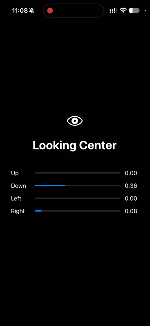

# ARKitPractice

A small SwiftUI practice app that uses **ARKit face tracking** to follow your eyes and show which direction you're looking: up, down, left, right or center.

<p align="center">
  
</p>

## Features

- Real-time eye tracking with the front TrueDepth camera
- On-screen message and SF Symbol arrow for the current gaze direction
- Live debug bars showing ARKit's raw 0–1 values for each direction
- A friendly fallback screen on devices without face tracking

## Requirements

- Xcode 27 or later
- iOS 27.2 or later
- An iPhone or iPad with **Face ID** (TrueDepth camera)

> The iOS Simulator has no TrueDepth camera, so it only shows the "Face Tracking Unavailable" screen. Run on a real device.

## Getting started

1. Open `ARKitPractice.xcodeproj` in Xcode.
2. Select the **ARKitPractice** target → **Signing & Capabilities**, and choose your Team.
3. Plug in your Face ID device, turn on Developer Mode (Settings → Privacy & Security → Developer Mode), and pick it as the run destination.
4. Press **⌘R**, then allow camera access when asked.
5. Hold the device about 30–40 cm from your face and move only your eyes.

## Project structure

```
ARKitPractice/
├── ARKitPracticeApp.swift   # App entry point
├── ContentView.swift        # UI: arrow, message, debug bars
└── EyeTracker.swift         # ARKit session + gaze direction logic
```

## How it works

1. `EyeTracker` runs an `ARSession` with `ARFaceTrackingConfiguration`.
2. Each frame, ARKit delivers an `ARFaceAnchor` with **blend shapes**: 0–1 values such as `eyeLookUpLeft` and `eyeLookInRight`.
3. The tracker averages both eyes for each direction and picks the strongest one.
4. If that value is above the threshold (0.4), it becomes the gaze direction; otherwise the eyes count as centered.
5. `EyeTracker` is `@Observable`, so `ContentView` updates automatically.

For a full line-by-line explanation, see [ARCHITECTURE.md](ARCHITECTURE.md).

## Tuning

Adjust `threshold` in `EyeTracker.swift`:

- **Too jumpy:** raise it (for example, 0.5–0.6)
- **Not reacting:** lower it (for example, 0.3)

ARKit's left and right blend shapes are mirrored relative to your own body. The formulas in `EyeTracker` already account for this.

## Ideas to try next

- Blink and wink detection (`eyeBlinkLeft` and `eyeBlinkRight`)
- Diagonal directions (up-left, down-right)
- Smoothing over the last few frames
- A live camera preview using `ARSCNView`
